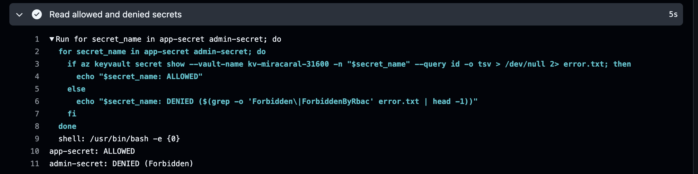
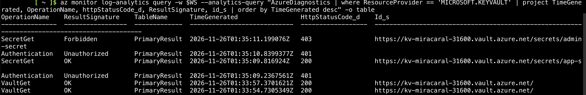
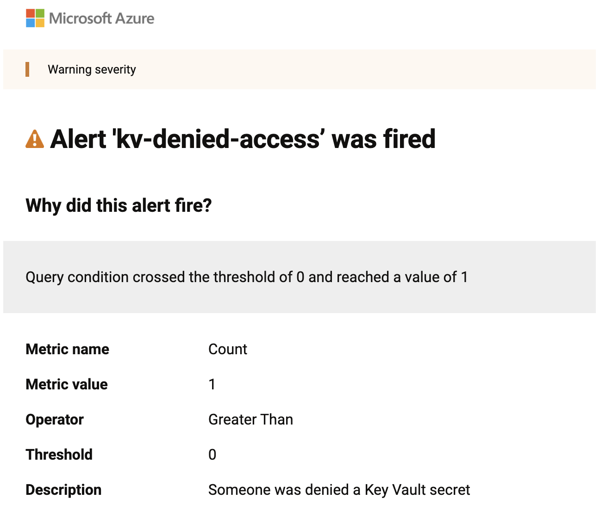
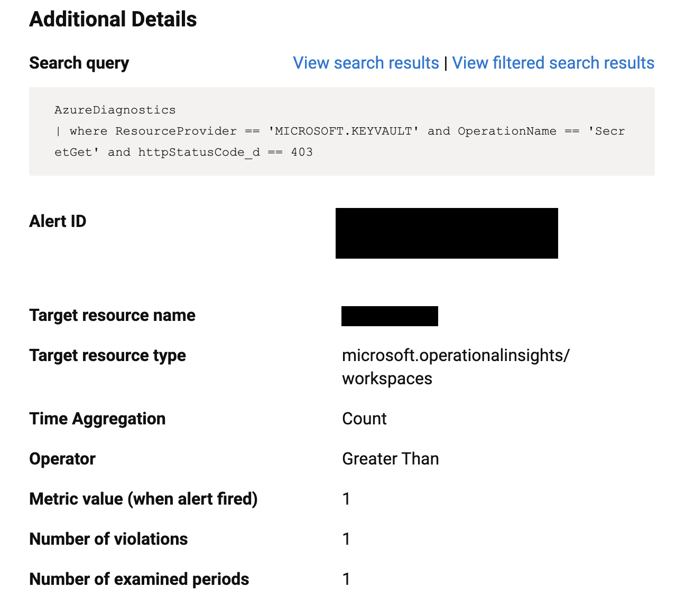

# Least privilege, audit and alerting on Azure (student account)

A small identity and monitoring lab on an Azure for Students subscription. One workload identity, one Key Vault with two secrets, and a chain that shows the whole loop: the identity can read only what it needs, every attempt is logged, and a denied attempt sends an alert.

The identity is the same one my site's GitHub Actions deploy uses ([multicloud-secure-static-site](https://github.com/miracaral/multicloud-secure-static-site)). It logs in with OIDC, so no secret is stored in GitHub.

## What I built

- **Key Vault in RBAC mode** (not access policies), with two test secrets: `app-secret` and `admin-secret` (fake values)
- **Least privilege at secret level**: the deploy identity got `Key Vault Secrets User` scoped to `app-secret` only, not to the vault. Its full rights are now: write to one storage account, read one secret.
- **Audit**: Key Vault `AuditEvent` logs sent to a Log Analytics workspace (30-day retention)
- **Alert**: a scheduled query rule that runs every 5 minutes and emails me when a secret read is denied (HTTP 403)
- **Cost guard**: a monthly budget of €5 with an email at 80%

## Proof

**1. Access control.** A manual GitHub Actions workflow logs in as the deploy identity and tries both secrets:

```
app-secret:   ALLOWED
admin-secret: DENIED (Forbidden)
```



**2. Audit.** Both attempts appear in the log, two seconds apart:

| Operation | Result | Secret |
| --- | --- | --- |
| SecretGet | 200 OK | `app-secret` |
| SecretGet | 403 Forbidden | `admin-secret` |

The `401 Unauthorized` rows next to them are normal: the client first calls without a token, Key Vault asks for one, then the real request follows.



**3. Alert.** The denied read crossed the threshold (0) and the rule fired by email within the 5-minute window.




## What the student account did not allow

My university's tenant does not let students create app registrations or new tenants (`allowedToCreateApps: false`, `allowedToCreateTenants: false`). So Conditional Access, PIM, Entra groups and access reviews were not possible. I kept to what a subscription owner can do: Azure RBAC, managed identity, Key Vault, monitoring.

Other things I ran into:
- Every new service had to be registered on the subscription first (`Microsoft.KeyVault`, `Microsoft.Insights`, ...)
- The alert rule failed with `RequestDisallowedByAzure` until I set its location to an allowed region (`francecentral`); without it Azure tried `global`
- The CLI's budget command did not accept scope and notifications, so I created the budget through the REST API (`az rest`)
- Azure now asks to verify an email address (one-time code) before an action group may send to it

## Rebuild it

[`setup.sh`](setup.sh) recreates everything in Azure Cloud Shell (set the variables at the top first). It expects the managed identity from the site project to exist. The test workflow is in [`.github/workflows/keyvault-test.yml`](.github/workflows/keyvault-test.yml); it reads the IDs from repository variables, so nothing about my subscription is in this repo.

## Cost

A few cents of student credit at most. Log Analytics stays within its free monthly allowance at this volume. All resources were deleted after the screenshots.
